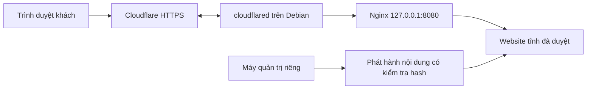

# Debian + Nginx + website tĩnh + Cloudflare Tunnel

Trạng thái 2026-11-12: **thiết kế, chưa triển khai lên UZ801**. v0.1.1 vẫn chỉ đọc Android. Không có script flash, provisioning, tài khoản Cloudflare hoặc tunnel được tạo trong đợt này.

## Điều kiện chuyển giai đoạn

| Giai đoạn | Bằng chứng cần có trước khi làm | Kết quả cần bàn giao |
|---|---|---|
| A. Giữ firmware gốc | Người dùng cho phép backup lớn riêng | Full user-area, SHA-256/readback, cả hai GPT và sidecar PASS, hai bản lưu riêng; ghi nhận giới hạn live |
| B. Xác minh recovery | Đúng PCB V3.2, eMMC, boot chain, programmer/hash và đường khôi phục được xem xét | Quy trình recovery cụ thể, người phụ trách và điểm dừng; chưa suy ra an toàn từ tên MSM8916 |
| C. Chọn Debian | Kernel/DTB/driver USB, Wi-Fi/RF, filesystem và userland có bằng chứng phù hợp đúng biến thể | Ma trận tương thích và kế hoạch quay lại firmware gốc; xin phép riêng mọi thay đổi thiết bị |
| D. Web cục bộ | Debian đã được cài và kiểm chứng trong một nhiệm vụ khác được phép | Nginx chỉ phục vụ website tĩnh, test tài nguyên và tính ổn định |
| E. Công khai website | Chủ tên miền phê duyệt hostname, nội dung và quyền truy cập | Tunnel đến đúng web origin, HTTPS hoạt động, thử rollback website |

MSM8916 không đủ để chọn ngay image hoặc ABI. Debian phân biệt armhf và arm64; boot/kernel của thiết bị ARM còn phụ thuộc nền tảng cụ thể. Android 32-bit đang chạy không chứng minh image Debian bất kỳ có thể boot. Chưa chọn bản Debian hay cloudflared cố định cho máy này. [Debian: Supported Hardware](https://www.debian.org/releases/stable/armhf/ch02s01.en.html)

## Kiến trúc dự kiến



Manager Windows tại `127.0.0.1:8765` là ứng dụng riêng: **không đưa manager, API ADB, cổng 5037, USB, thư mục backup hoặc history qua tunnel**. Địa chỉ loopback trên Debian là một máy khác với loopback Windows. Chỉ hostname website được ánh xạ tới Nginx.

Cloudflare Tunnel tạo kết nối đi ra từ cloudflared, không đòi địa chỉ IP công khai tại origin. Khi triển khai, kiểm tra mạng LTE/Wi-Fi, DNS, đồng hồ TLS và chính sách outbound của mạng thực tế. Không giả định thiết bị giữ kết nối sau mất sóng. [Cloudflare Tunnel](https://developers.cloudflare.com/cloudflare-one/networks/connectors/cloudflare-tunnel/)

## Website và Nginx

Đề xuất nội dung HTML/CSS/JS tĩnh, build trên máy phát triển, không chạy bundler hoặc database trên USB có RAM khả dụng khoảng 388.5 MiB. Dùng thư mục release riêng, kiểm tra hash trước khi đổi `current`, giữ một release trước đó để quay lại. Web worker chỉ đọc nội dung; tài khoản triển khai có quyền cập nhật release.

Mẫu cấu hình dưới đây chỉ để review, chưa được nạp hoặc chạy. Nginx hỗ trợ phục vụ tệp bằng `root`/`location`; cần kiểm tra cấu hình bằng công cụ Nginx trên môi trường mục tiêu trước khi reload. [Nginx Beginner’s Guide](https://nginx.org/en/docs/beginners_guide.html)

```nginx
server {
    listen 127.0.0.1:8080;
    server_name site.example.com;
    root /srv/openstick-site/current;
    index index.html;
    autoindex off;
    server_tokens off;
    location / { try_files $uri $uri/ =404; }
    location ~ /\. { deny all; }
    location /api/ { return 404; }
    add_header X-Content-Type-Options nosniff always;
    add_header Referrer-Policy strict-origin-when-cross-origin always;
}
```

`site.example.com` chỉ là placeholder. Không đặt ảnh firmware, manifest, credentials, `.git` hoặc tệp hệ thống trong webroot. CSP của website cần thiết kế theo nội dung thật. Log phải giới hạn dung lượng/thời gian lưu; hạn chế ghi liên tục để giảm hao mòn eMMC.

## Tunnel và vận hành

Chọn ARM/ARM64 theo **Debian thực tế**, kiểm tra yêu cầu kernel/userland và bản phát hành được hỗ trợ khi triển khai. Cloudflare có gói ARM và ARM64 nhưng điều đó chưa chứng minh chạy được trên kernel Android 3.10.28 này. Không cài cloudflared trực tiếp lên Android trong nhiệm vụ hiện tại. [Cloudflared downloads](https://developers.cloudflare.com/cloudflare-one/networks/connectors/cloudflare-tunnel/downloads/)

Đề xuất named tunnel, ánh xạ duy nhất hostname đã duyệt tới `http://127.0.0.1:8080`, cuối danh sách ingress trả HTTP 404. Credentials lưu ngoài webroot, quyền đọc giới hạn, không commit token/UUID riêng lên GitHub. Các rule được đánh giá theo thứ tự; kiểm tra ingress trước khi công khai. Website riêng tư cần thêm chính sách Access tương ứng. [Tunnel configuration file](https://developers.cloudflare.com/cloudflare-one/networks/connectors/cloudflare-tunnel/do-more-with-tunnels/local-management/configuration-file/)

Chạy Nginx/cloudflared dưới tài khoản dịch vụ với quyền tối thiểu; supervisor có giới hạn restart, log rotation và giới hạn tài nguyên sau khi đo. Theo dõi RSS, MemAvailable, CPU, nhiệt độ, dung lượng trống, HTTP 5xx và reconnect. Mục tiêu ban đầu để nghiệm thu: chạy tải nội dung thật ít nhất 24 giờ, không OOM/thermal throttling kéo dài, còn tối thiểu 100 MiB MemAvailable và 512 MiB dung lượng trống. Đây là mục tiêu đề xuất, chưa phải số đo hay cam kết hiệu năng.

## Nghiệm thu và quay lại

1. Test origin: trang chính, assets, 404, không directory listing và không đọc dotfile/API/backup.
2. Test HTTPS từ mạng ngoài; xác minh hostname đúng website, không mở cổng quản trị.
3. Test reconnect khi gián đoạn mạng có kiểm soát trong giai đoạn được phép; kiểm tra log và giới hạn restart.
4. Đổi sang release tĩnh trước nếu nội dung lỗi; thu hồi route/tunnel nếu công khai nhầm. Thử rollback website riêng với rollback firmware.
5. Bàn giao chủ tài khoản, lịch cập nhật, nơi giữ secrets, phiên bản/hash package và bằng chứng đo tải.

Mọi thao tác flash, reboot hoặc provisioning ở các giai đoạn sau cần nhiệm vụ và cho phép riêng. Tài liệu này không mở khóa bất kỳ safety gate nào của manager.
